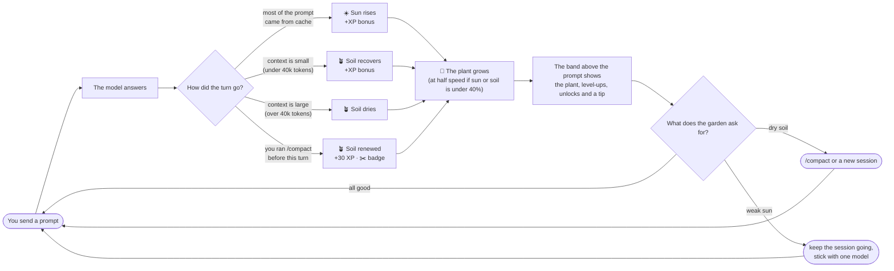
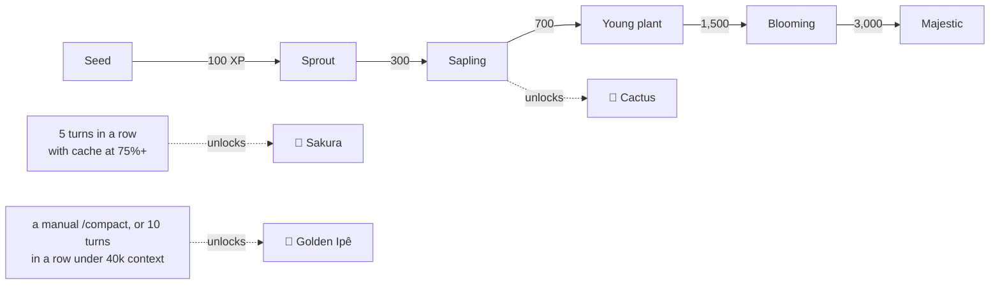

# Virtual Garden 🌱

**A small plant that grows when you use AI efficiently.**

Every request to a model re-reads the whole conversation. How much compute, energy and water that costs depends a lot on two habits nobody sees:

- **Prompt caching.** A prompt read from cache costs a fraction of a fresh one. Long, steady sessions cache well; restarts, model switches and long pauses don't.
- **Context size.** A 150k-token conversation is re-read on every call. Pruning it with `/compact`, or starting a new session for a new task, makes every later call cheaper.

Virtual Garden turns those habits into something you can see: a plant above the prompt that gets **sun** from caching and **fresh soil** from a lean context, and grows with every answered turn. It rewards and never scolds. A careless turn only slows the plant down. Nothing dies, and there are no warnings.

It is the companion of [Friendly Reminder](../friendly-reminder), which shows the water and energy behind each response. Friendly Reminder shows the cost; Virtual Garden makes lowering it a habit.

```
🎍 Bonsai · Young plant (Lv 4/6) · 120/800 XP · ☀️ 92% · 🪴 Soil 81%
```

It works in **Claude Code** and **Google Antigravity (`agy`)**, and both tend the same garden. It speaks English and Portuguese, needs only `python3` 3.8+, and has no dependencies.

## Contents

- [How you use it](#how-you-use-it)
- [Install](#install)
- [How it grows](#how-it-grows)
- [Settings](#settings)
- [Commands](#commands)
- [Where the garden lives](#where-the-garden-lives)
- [Troubleshooting](#troubleshooting)
- [Architecture](docs/ARCHITECTURE.md): components, module dependencies, sequence diagrams, data model

## How you use it

You don't do anything special: you work as usual and the garden reacts after each response.



Over days and weeks, the plant moves through six stages and new species unlock as you build the habits:



### What you see

After each response, Claude Code shows one line above the prompt, with three buttons:

| Button | What it does |
|---|---|
| **View garden** / **Collapse** | Switches between the line and the full garden |
| **Options** | Picks the format, the plant and the language |
| **Hide** | Hides the band until the session ends |

The full garden:

```
┌──────────────────────────────────────────────┐
│ 🎍 Bonsai · Young plant               Lv 4/6 │
├──────────────────────────────────────────────┤
│                   .-~~~-.                    │
│                  ( ~ ~ ~ )                   │
│                   '-.|.-'.-.                 │
│                      |__(~ )                 │
│                      |   '-'                 │
│                      |                       │
│                  \=======/                   │
│                   \_____/                    │
├──────────────────────────────────────────────┤
│ Growth [██░░░░░░░░░░░░] 120/800 XP           │
│ ☀️ Sun 92%   🪴 Soil 81%   Turns 57          │
│ Garden 🎍 4/6  🌵 1/6  🔒  🔒                │
│ Badges ✂️ Pruner                             │
├──────────────────────────────────────────────┤
│ 💡 Ask for the change, not the whole file    │
│    back: fewer output tokens, less energy.   │
└──────────────────────────────────────────────┘
```

- **Header:** the plant you're tending, its stage, and its level out of 6.
- **Growth:** XP within the current stage.
- **Sun and soil:** the two health bars, from 0 to 100%.
- **Garden:** every species' level, with 🔒 for the ones still locked.
- **Badges:** the badges you've earned.
- **News and tip:** level-ups, unlocks and badges from this turn, then a tip about whatever the garden needs most.

## Install

### Claude Code

```text
/plugin marketplace add leon-lourenco/green-ai
/plugin install virtual-garden@green-ai
```

Then run `/reload-plugins`, or restart Claude Code. The band appears after the next response. You can also just ask Claude ("show my garden", "switch to the cactus"): the plugin's `garden` skill runs the script for you.

### Google Antigravity (`agy`)

Register the hook once, from the plugin folder:

```bash
./scripts/virtual-garden-agy --install-hook
```

This adds a `Stop` hook with the script's absolute path to `~/.gemini/config/hooks.json`, and keeps any hooks already there. Inside this repository, `.agents/hooks.json` does the same for the workspace.

After each turn, the hook grows the garden without adding anything to the conversation. Antigravity hooks can't show text, so you look at the garden yourself:

```bash
./scripts/virtual-garden-agy --text    # one line
./scripts/virtual-garden-agy --full    # the whole garden
```

Inside this repository, the workspace skill `.agents/skills/virtual-garden` lets the agent run it for you.

## How it grows

Each answered turn is applied **once**: redrawing the band, changing a setting or running the script again never counts it twice.

### Sun ☀️ — prompt caching

The share of the turn's prompt that was read from cache. Tokens written to the cache count as not cached.

| Cache hit rate | XP bonus | Sun |
|---|---|---|
| 90% or more | +20 | +8 |
| 75% or more | +10 | +4 |
| 40% or more | +5 | no change |
| less than 40% | none | −6, never below 20% |

The first turn of a session is not judged, since nothing is cached yet; it earns +5. A break of an hour or more restores 10% of sun.

### Soil 🪴 — context size

How full the context window was on the turn's last call.

| Context | Soil | Never below |
|---|---|---|
| over 120k tokens | −15 | 20% |
| over 80k tokens | −8 | 40% |
| over 40k tokens | −3 | 60% |
| 40k or less | +3, and +5 XP | |

`/compact` or a new session brings the soil back to 100%. Only a `/compact` you run yourself earns the +30 XP and the ✂️ Pruner badge; an automatic compaction renews the soil and nothing more. agy writes no compaction marker, so there the soil renews with a new conversation.

### XP 🌱

Every turn earns 10 XP, plus the sun and soil bonuses above. While sun **or** soil is below 40%, the turn's XP is halved and the garden shows 🐌.

| Stage | Starts at |
|---|---|
| Seed | 0 XP |
| Sprout | 100 |
| Sapling | 300 |
| Young plant | 700 |
| Blooming | 1,500 |
| Majestic | 3,000 |

### Collection

Each species keeps its own growth, so switching plants never loses any.

| | Species | Unlocked by | Teaches |
|---|---|---|---|
| 🎍 | Bonsai | from the start | |
| 🌵 | Cactus (Mandacaru) | growing any plant to Sapling | consistency |
| 🌸 | Sakura (Cerejeira) | 5 turns in a row with the cache at 75%+ | caching |
| 🌼 | Golden Ipê (Ipê-amarelo) | a manual `/compact`, or 10 turns in a row under 40k tokens of context | a lean context |

### Badges

| Badge | Earned by |
|---|---|
| ✂️ Pruner | a manual `/compact` |
| ☀️ Sunny | 5 turns in a row with the cache at 75%+ |
| 🍃 Light | 10 turns in a row under 40k tokens of context |
| 🏆 Master | a plant reaching Majestic |
| 🧺 Collector | every species unlocked |

## Settings

Set them in the band's **Options**, in `/config`, or with `/plugin configure virtual-garden@green-ai`.

| Setting | Values | Default |
|---|---|---|
| `format` | `short` (one line), `full` (the whole garden), `off` (keeps growing, shows nothing) | `short` |
| `species` | `current` (the plant you're growing), `bonsai`, `cactus`, `sakura`, `ipe` | `current` |
| `language` | `auto` (Claude Code's `language` setting, then the system locale), `en`, `pt` | `auto` |

If you pick a locked species, the band tells you how to unlock it, and you keep tending the current one. The agy script reads the same settings from `CLAUDE_PLUGIN_OPTION_FORMAT`, `CLAUDE_PLUGIN_OPTION_SPECIES` and `CLAUDE_PLUGIN_OPTION_LANGUAGE`.

## Commands

Both scripts run with any `python3` 3.8+ and never read stdin when given a flag, so they are safe to run from an agent's shell.

| Command | What it does |
|---|---|
| `scripts/virtual-garden --text` | The one-line summary (Claude Code side: reads the garden, changes nothing) |
| `scripts/virtual-garden --full` | The whole garden |
| `scripts/virtual-garden --switch SPECIES` | Tend another unlocked species |
| `scripts/virtual-garden-agy --text` / `--full` | Same, after applying your latest agy turn if the hook hasn't |
| `scripts/virtual-garden-agy --transcript PATH` | Use a specific agy conversation |
| `scripts/virtual-garden-agy --install-hook` | Register the agy `Stop` hook |

## Where the garden lives

One file, `garden-state.json`, in `~/.claude/plugins/data/virtual-garden-green-ai/`. `VIRTUAL_GARDEN_DATA` or `CLAUDE_PLUGIN_DATA` override the folder. Claude Code, agy and manual runs all read and write it under a lock, so sessions running at the same time never lose each other's growth. A 0.1.0 garden is read and carried over.

The plugin reads your local transcripts to find turns, token counts and compaction markers. The garden file keeps only counters and turn ids, nothing you wrote. It makes no network calls and never touches credentials.

## Troubleshooting

| Symptom | What to check |
|---|---|
| No band after a response | Run `/reload-plugins`, and check `format` isn't `off` and that you didn't press **Hide** this session. |
| The garden didn't change | Look for `error.log` in the garden folder: the hook logs every failure there instead of interrupting you. |
| Wrong language | `language` is `auto` and follows Claude Code's `language` setting, then the system locale. Set `en` or `pt`. |
| agy turns don't count | Run `./scripts/virtual-garden-agy --install-hook` and check `~/.gemini/config/hooks.json`. |

## License

MIT
