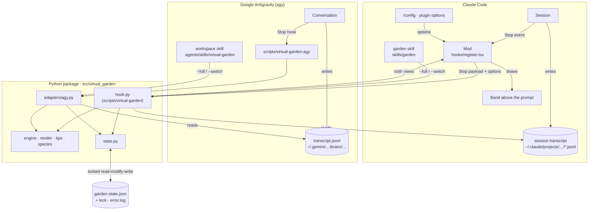
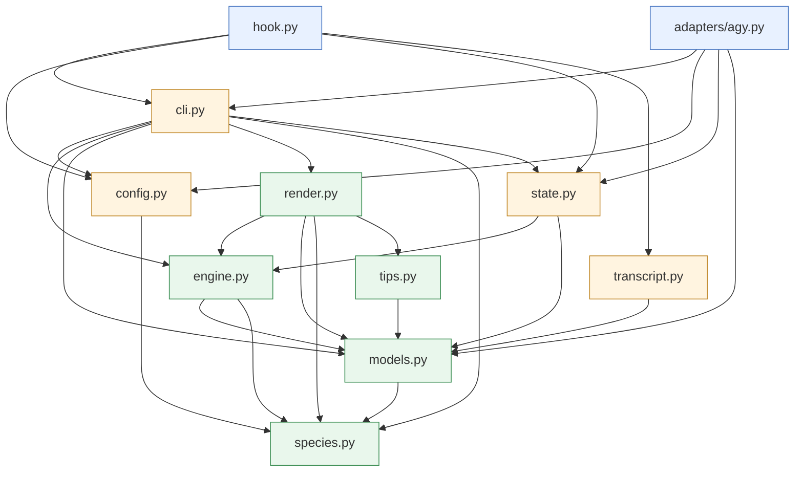
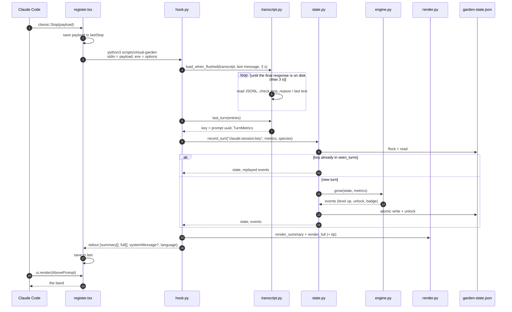
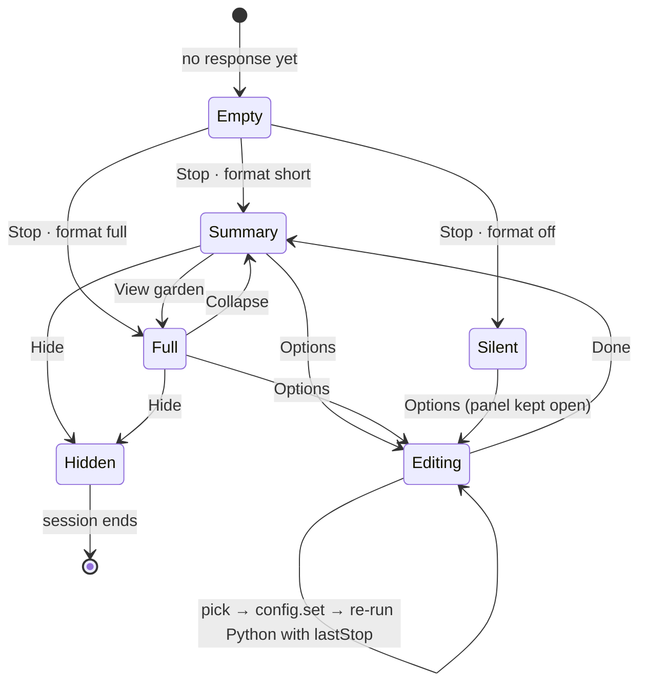
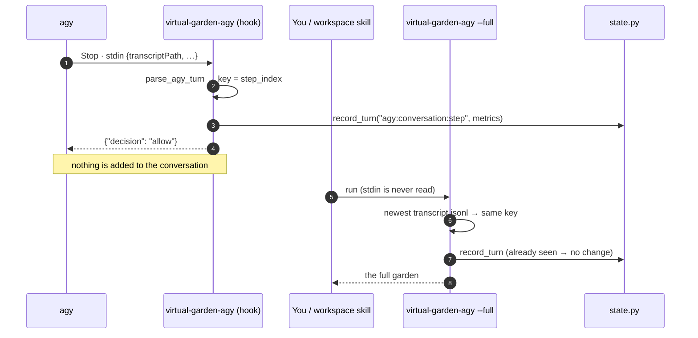
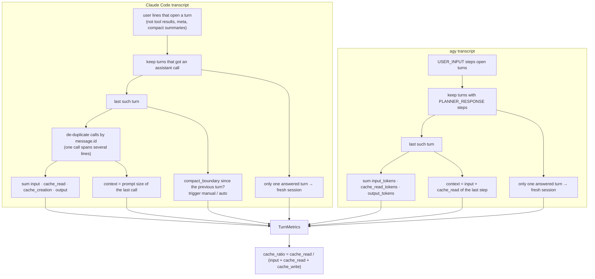
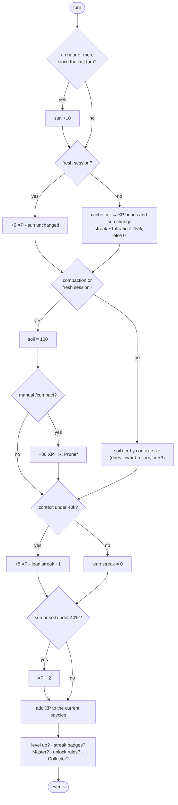
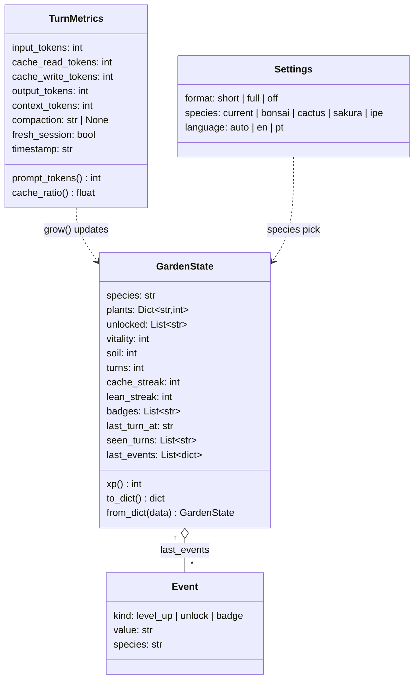

# Virtual Garden — Architecture

This document is for people changing the plugin. For what it does and how to use it, see the [README](../README.md).

- [Design principles](#design-principles)
- [Top level](#top-level)
- [Repository layout](#repository-layout)
- [Module dependencies](#module-dependencies)
- [Claude Code: one response](#claude-code-one-response)
- [Claude Code: the band](#claude-code-the-band)
- [Google Antigravity](#google-antigravity)
- [Measuring a turn](#measuring-a-turn)
- [Growing the garden](#growing-the-garden)
- [Data model](#data-model)
- [Counting a turn once](#counting-a-turn-once)
- [Rendering](#rendering)
- [Testing](#testing)

## Design principles

| Principle | What it means in the code |
|---|---|
| **Never disrupt a session** | Every entry point catches all errors, logs them to `error.log` and exits 0. The band's TypeScript swallows failures too. |
| **Zero dependencies** | Python standard library only, 3.8+. The mod uses only the Claude Code mod API. |
| **One garden, many tools** | Claude Code, agy and manual runs share one state file, written under a lock. |
| **A turn counts once** | Each turn has a stable key; applying it again is a no-op that returns the same news. |
| **Reward, never punish** | Bad turns slow growth (halved XP, floors on sun and soil); nothing decreases XP or kills the plant. |
| **Pure core, thin edges** | `engine` and `render` are pure functions of the state; I/O lives in `transcript`, `state` and the entry points. |

## Top level

Who talks to whom. The Python package does all the measuring and drawing. The TypeScript mod only stores what Python returns and shows it. The mod passes the Stop payload on stdin and the options as `CLAUDE_PLUGIN_OPTION_*` variables; Python answers on stdout with both views (`summary`, `full`).



## Repository layout

```
plugins/virtual-garden/
├── .claude-plugin/plugin.json    manifest: name, version, userConfig (format, species, language)
├── hooks/
│   ├── hooks.json                registers the mod module
│   └── register.tsx              the band: Stop handler + AbovePrompt renderer
├── types/index.d.ts              the mod's state atoms (GardenView, view, …)
├── skills/garden/SKILL.md        lets Claude show or switch the garden
├── scripts/
│   ├── virtual-garden            launcher → virtual_garden.hook.main
│   └── virtual-garden-agy        launcher → virtual_garden.adapters.agy.main
├── src/virtual_garden/
│   ├── hook.py                   Claude Code entry point (Stop payload or manual flags)
│   ├── adapters/agy.py           Antigravity entry point, transcript parser, --install-hook
│   ├── cli.py                    shared by both: output views, manual commands, error log
│   ├── transcript.py             Claude Code transcript → (turn key, TurnMetrics)
│   ├── state.py                  garden file: load, atomic save, lock, record_turn
│   ├── engine.py                 the rules: XP, sun, soil, unlocks, badges
│   ├── render.py                 summary line, full box, news, terminal widths
│   ├── tips.py                   tip picked by what the garden needs
│   ├── species.py                catalog: names, icons, stage names, ASCII sprites
│   ├── models.py                 TurnMetrics, Event, GardenState (+ 0.1.0 migration)
│   └── config.py                 settings, language detection, data folder
├── tests/                        unittest suites (no third-party runner needed)
└── docs/ARCHITECTURE.md          this file
```

Outside the plugin folder, the repository adds `.claude-plugin/marketplace.json` (the Claude Code catalog) and `.agents/` (agy workspace hook, skill and rule).

## Module dependencies

Arrows point from a module to what it imports. The graph has no cycles. `species` and `models` are the foundation, `engine` and `render` are pure logic, and only the top row does I/O.



| Layer | Modules | May do I/O |
|---|---|---|
| Entry points | `hook`, `adapters/agy` | stdin, stdout, transcripts |
| Shared edges | `cli`, `transcript`, `state`, `config` | files, environment |
| Pure core | `engine`, `render`, `tips`, `models`, `species` | no |

## Claude Code: one response

What happens between the model finishing a response and the band changing. The Python process is short-lived: it starts, measures, saves and exits on every response.



## Claude Code: the band

The band's state lives in mod atoms (`types/index.d.ts`). Switching views never runs Python, because both views arrive in every response. Changing a setting runs Python again with the saved Stop payload, which is safe because the turn is already recorded.



| Atom | Holds |
|---|---|
| `last` | the last `GardenView` (`summary`, `full`, `language`) |
| `lastStop` | the last Stop payload, to redraw after a setting changes |
| `view` | `summary`, `full`, or `null` to follow the `format` setting |
| `isEditing` | the Options panel is open |
| `isHidden` | Hide was pressed this session |

## Google Antigravity

agy hooks can't show text and must let the agent stop, so the hook only records the turn. The user sees the garden from a manual run, which applies the latest turn too, in case the hook isn't installed. Both use the same key, so the turn counts once.



## Measuring a turn

Both transcripts become the same `TurnMetrics`. Only the parsing differs.



## Growing the garden

`engine.grow(state, turn)` applies one turn in place and returns the events to celebrate. The constants are at the top of `engine.py`.



Unlock rules (`engine.unlock_rule_met`) are checked after every turn, so a species unlocks on the turn its condition first holds.

## Data model



`garden-state.json` is `GardenState.to_dict()` plus `"version": 1`. A file without `version` is a 0.1.0 garden and goes through `models._from_v0` (one XP pool → `plants`, renamed fields and badges). Unknown species are dropped and the current plant falls back to the bonsai, so a hand-edited or future file can't break the hook.

## Counting a turn once

Every entry point derives the same key for the same turn:

| Source | Key |
|---|---|
| Claude Code | `claude:<session_id>:<prompt uuid>` |
| agy | `agy:<conversation folder id>:<USER_INPUT step_index>` |

`state.record_turn` keeps the last 500 keys in `seen_turns`:

- **A new key:** the turn is applied, and its events are saved in `last_events`.
- **The latest key again** (a band redraw, a settings change): nothing is applied, and the saved events come back, so the news stays on screen.
- **An older key:** nothing is applied, and no events come back.

All of it happens inside `state.editing`, which holds an exclusive `fcntl.flock` on `garden-state.lock` from the read to the atomic replace (temp file + `os.replace`). On Windows there is no lock, but the write is still atomic.

## Rendering

- `render_summary` and `render_full` are pure: same state, language and seed, same lines. The tip seed is `session:turn`, so a redraw shows the same tip.
- Widths are terminal columns (`render.width`): East Asian wide characters and emoji count 2, a narrow symbol followed by U+FE0F (☀️, ✂️) counts 2, and combining marks and ZWJ count 0. Code points U+1F000–U+1FAFF count 2 even when Python 3.8's Unicode tables don't know them (🪴).
- The box is `INNER` = 46 columns wide. Text wraps between words (`wrap`), and badges wrap without splitting one (`wrap_items`).
- A sprite is drawn as one block, padded to its widest line and centered as a whole. The pot is shifted under the trunk (`species._trunk_column`), so stages wider than the pot stay upright.
- Every user-facing word is in `WORDS`, `BADGE_LABELS`, `UNLOCK_HINTS`, `species.NAMES` and `species.STAGE_NAMES`, in `en` and `pt`.

## Testing

```bash
python3 -m unittest discover -s tests     # from the plugin root
ruff check src tests
```

| Suite | Covers |
|---|---|
| `test_engine.py` | stage thresholds, every sun and soil tier and floor, fresh sessions, manual vs auto compaction, slow growth, rest, unlocks, badges, per-species growth |
| `test_render.py` | terminal widths, wrapping, every sprite fitting the box, **every line of every box the same width** for all species, stages and languages, no English in `pt` |
| `test_state.py` | round trip, broken files, 0.1.0 migration, a turn counting once, event replay, species picks |
| `test_transcript.py` | call de-duplication, context from the last call, unanswered prompts, compaction detection, flush wait |
| `test_entry_points.py` | the Claude hook end to end (formats, idempotency, error log), manual runs never reading stdin, `--switch`, the agy hook answer, `--install-hook` |

The suites run on Python 3.8 and on current versions. The mod (`register.tsx`) has no automated tests; `claude plugin validate` checks its hooks and state atoms.
